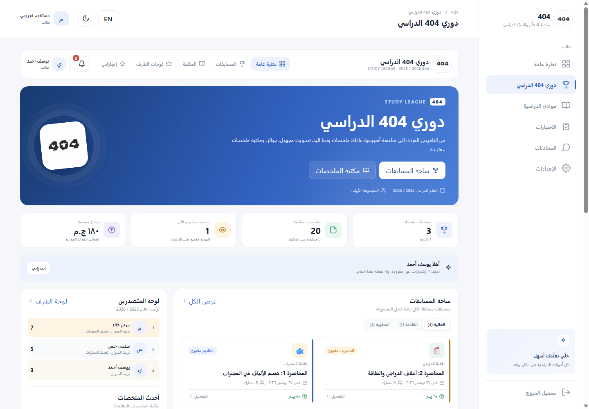
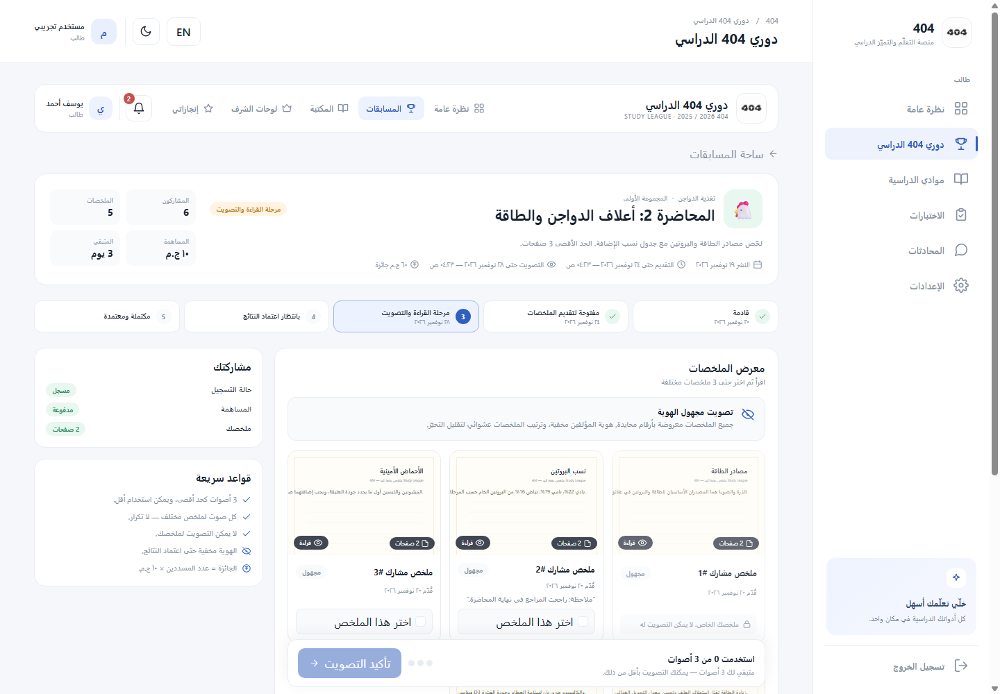
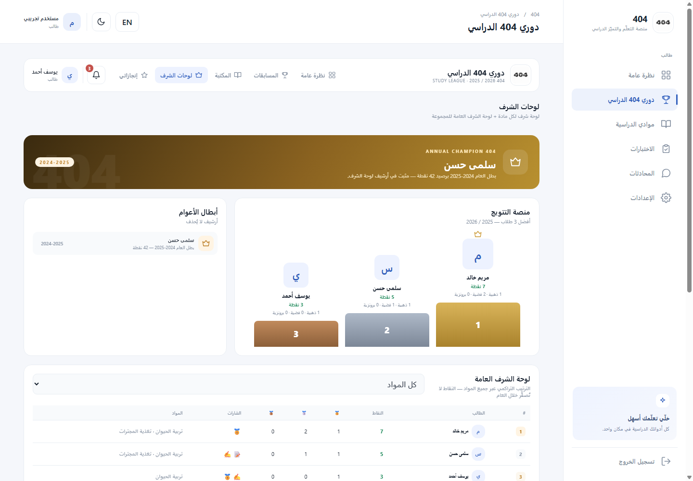
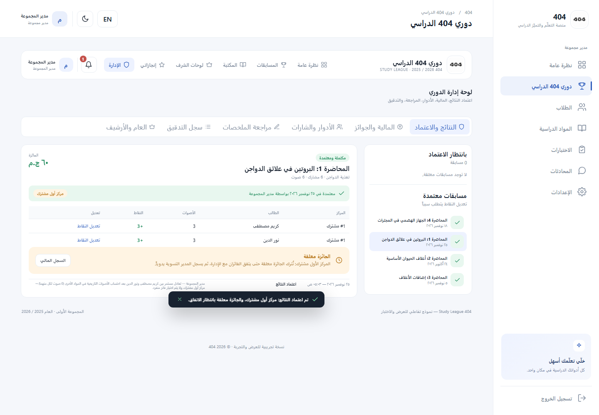

# دوري 404 الدراسي — 404 Study League

منصة تعليمية عربية (RTL) مبنية على مشروع **404 / مَدرستي**، مع وحدة **404 Study League** كاملة: مسابقات أسبوعية لكل مادة، تقديم ملخصات بخط اليد، تصويت مجهول، جوائز مالية، نتائج بنقاط سنوية، مكتبة ملخصات معتمدة بقارئ كتاب، وتحميل PDF.

**Live Demo:** https://study-league-404.vercel.app



> البيانات تجريبية وتُحفظ في `localStorage` داخل المتصفح. وحدة الدوري تعمل بطبقة خدمات (Services) تفرض القواعد وتمنع تجاوزها من الواجهة، مع توثيق كامل في `audit`.

## لقطات الشاشة

| لوحة الدوري | التصويت المجهول |
| --- | --- |
|  |  |

| لوحة الشرف | اعتماد المركز المشترك |
| --- | --- |
|  |  |

## التحقق

```bash
npm run test:rules
```

يغطي 19 اختباراً: تجهيز البيانات، إخفاء الهوية، حدود التصويت (3 كحد أقصى وأقل من ذلك مسموح)، منع التصويت الذاتي والتكرار، المواعيد، صلاحيات الاعتماد والنشر، التعادل التاريخي والمركز الأول المشترك، الجائزة المعلقة والتسوية اليدوية، الأدوار مقابل الشارات، النقاط، وإغلاق العام.

تم أيضاً اختبار نسخة الإنتاج في متصفح آلي: تسجيل الدخول بالأدوار الثلاثة، التصويت والقفل، رفع الملخصات، قارئ الكتاب (صفحتان RTL + عرض عادي)، تحميل PDF عربي وZIP، اعتماد نتائج مشتركة، تسوية الجائزة، النشر، وسجل التدقيق — بدون أخطاء JavaScript.

## خطوات الوصول (Gmail / Vercel)

راجع [`docs/DEPLOYMENT_NOTES.md`](docs/DEPLOYMENT_NOTES.md). باختصار: إنشاء Gmail يتطلب تحقق هاتف (خطوة بشرية)، ودعوة عضو إلى فريق Vercel مرفوضة على خطة Hobby؛ يلزم ترقية الخطة أو نقل المشروع للحساب الجديد بعد إنشائه. الموقع والمستودع متاحان للعرض الآن.

## الحسابات التجريبية

| الدور | الاسم | كود الدخول |
| --- | --- | --- |
| مدير مجموعة | أحمد محمد | `ADMIN-404` |
| طالب (يوسف) | يوسف أحمد | `STU1001` |
| مدير المنصة | إدارة المنصة | `OWNER-404` |

يمكن أيضاً استخدام أكواد الطلاب `STU1002` … `STU1006`. أزرار «تعبئة سريعة» في صفحة الدخول تملأ البيانات تلقائياً.

## جولة سريعة (Test Script)

1. **طالب** — ادخل بـ `STU1001` ثم افتح **دوري 404 الدراسي**.
2. **التصويت:** مسابقات ← «أعلاف الدواجن والطاقة» (التصويت مفتوح). الملخصات مجهولة، ملخصك معلَّم بـ«ملخصك الخاص». اختر حتى 3 ملخصات ثم أكّد — يُثبَّت التصويت ولا يمكن تعديله.
3. **التقديم:** مسابقات ← «هضم الألياف» (التقديم مفتوح). ارفع صور ملخص (JPG/PNG) وأرسله.
4. **القراءة:** المكتبة ← أي ملخص ← يفتح **قارئ الكتاب** افتراضياً بصفحتين على سطح المكتب وصفحة واحدة على الجوال، مع أسهم لوحة المفاتيح وتبديل «العرض العادي» مع الحفاظ على الموضع.
5. **PDF:** زر «تحميل PDF» داخل القارئ أو من بطاقة الملخص، و«تحميل الكل» لإنشاء ZIP بملفات PDF منفصلة.
6. **مدير المجموعة** — ادخل بـ `ADMIN-404`:
   - الإدارة ← النتائج: افتح مسابقة «البروتين في علائق الدواجن» (قيد الاعتماد). ستجد تعادلاً على المركز الأول تم كسره بالأصوات التاريخية في المواد الأخرى، ثم تعادل مستمر ← **مركز أول مشترك**، والجائزة معلقة.
   - اعتمد النتائج (مع اختيار قاعدة المركز التالي) ← تُكشف الهويات، تُمنح 3 نقاط لكل فائز مشترك، وتُسجّل الشارات والإشعارات.
   - المالية: سجّل اتفاق الفائزين المشترك (مبلغ + مستلمون + ملاحظات) — لا يوجد تقسيم تلقائي.
   - الأدوار: امنح/اسحب `Summary Contributor` أو عيّن `Summary Editor` (سبب إلزامي).
   - المراجعة: اعتمد ملخصاً رقمياً فائزاً وانشره في المكتبة (بطاقة التوثيق مثبتة).
   - سجل التدقيق: كل إجراء حساس له سجل غير قابل للتعديل.
7. **إغلاق العام:** الإدارة ← العام والأرشيف ← إغلاق العام ← تتويج **404 Annual Champion** وأرشفة الترتيب.

## المطابقة للمتطلبات

| المتطلب | التنفيذ |
| --- | --- |
| مسابقات مستقلة لكل مادة | `Competitions` مرتبطة بـ`subjectId` و`groupId` |
| دورة حياة الحالات الخمس | `UPCOMING → SUBMISSION_OPEN → VOTING_OPEN → PENDING_APPROVAL → COMPLETED` مع تحقق في الخدمات |
| تقديم ملخصات بخط اليد | رفع حتى 6 صور + ملاحظات، واستبدال قبل الموعد فقط |
| إخفاء الهوية | مشروع عرض مجهول بدون `studentId/name/code/avatar`، ترقيم محايد وترتيب عشوائي، والكشف بعد الاعتماد فقط |
| 3 أصوات كحد أقصى | تحقق من التكرار، اختيار ملخصات مختلفة، السماح بأقل من 3، وقفل نهائي |
| منع التصويت الذاتي | في الواجهة والخدمة (`voterId !== submission.studentId`) |
| إخفاء العدادات | لا تُعرض الأصوات للطلاب قبل الاعتماد |
| المساهمة 10 ج.م والجائزة | `prizePool = paidParticipants × fee` مع سجل مالي لكل مشارك |
| التعادل التاريخي | مجموع الأصوات في مسابقات مواد أخرى مكتملة، مع توثيق الحساب في النتيجة/التدقيق |
| المركز الأول المشترك | 3 نقاط لكل فائز، الجائزة `ON_HOLD_FOR_JOINT_WINNER_AGREEMENT`، وتسوية يدوية |
| النقاط السنوية | `PointsLedger` غير قابل للحذف، 3/2/1، منع التكرار، أرشيف أعوام |
| شارات وأدوار | `Summary Contributor` شارة عرض فقط، `Summary Editor` دور للمراجعة الأولية دون نشر |
| مكتبة وقارئ كتاب | قارئ افتراضي بصفحتين RTL، جوال بصفحة واحدة، تبديل عرض مع حفظ الموضع، توثيق مؤلف مقفول |
| PDF وZIP | توليد PDF للصور والملخصات الرقمية (بدون مكتبات خارجية) + ZIP لتحميل الكل |
| لوحات الشرف | لكل مادة + عامة مع منصة تتويج وإحصاءات ميداليات |
| الإشعارات والتدقيق | إشعارات بأحداث الدوري وروابط عميقة، وسجل تدقيق لكل إجراء حساس |
| RBAC | تحقق في طبقة الخدمات + إخفاء عناصر الواجهة حسب الدور |
| الوصول للمكتبة | مقتصر على طلاب المجموعة؛ لا روابط تخزين عامة |

## المعمارية

```
src/
├── App.jsx                 # منصة 404 (تسجيل الدخول + اللوحات الحالية) + تكامل الدوري
├── league/
│   ├── LeagueApp.jsx       # هيكل الدوري والتنقل والإشعارات
│   ├── domain.js           # الثوابت، البيانات التجريبية، قواعد التصويت والتعادل والنقاط
│   ├── store.jsx           # حالة الدوري + localStorage + ربط الخدمات
│   ├── ui.jsx              # مكونات واجهة مشتركة وأيقونات SVG
│   ├── BookReader.jsx      # قارئ الكتاب + عارض الصور
│   ├── pdf.js              # توليد PDF عربي RTL وZIP بدون مكتبات
│   ├── components/
│   │   └── CompetitionCard.jsx
│   ├── services/
│   │   ├── common.js       # صلاحيات، تدقيق، إشعارات، أخطاء
│   │   ├── competitions.js # إنشاء/تعديل/انضمام/تقديم/انتقال الحالات
│   │   ├── voting.js       # التصويت والقفل ومنع التكرار والتصويت الذاتي
│   │   ├── results.js      # الاعتماد، كسر التعادل، النقاط، إغلاق العام
│   │   ├── finance.js      # المساهمات، الجوائز، التسوية المشتركة
│   │   ├── roles.js        # الشارات والأدوار
│   │   └── library.js      # نشر الملخصات والمراجعة الأولية
│   └── views/
│       ├── Dashboard.jsx
│       ├── Competitions.jsx
│       ├── VotingGallery.jsx
│       ├── Library.jsx
│       ├── HallOfFame.jsx
│       ├── Achievements.jsx
│       └── AdminConsole.jsx
```

## التشغيل محلياً

```bash
npm install
npm run dev
npm run build
```

## النشر

```bash
vercel --prod
```

## حدود النسخة الحالية

- لا يوجد خادم أو قاعدة بيانات: القواعد تُفرض في طبقة خدمات داخل المتصفح، والبيانات في `localStorage`. في الإنتاج يجب نقل نفس القواعد إلى API + قاعدة بيانات (مع قيود فريدة `(competition_id, voter_id, submission_id)` وتخزين خاص للملفات).
- رفع الملفات يخزّن الصور كـ Data URLs محلياً (حد ~5MB للتخزين)؛ الإنتاج يحتاج تخزيناً سحابياً موقّعاً.
- توليد PDF يتم في المتصفح (بدون خادم) لضمان عمل النسخة التجريبية؛ الملفات الكبيرة جداً قد تحتاج معالجة خلفية.
- لا توجد مصادقة حقيقية؛ أكواد الدخول تجريبية.
